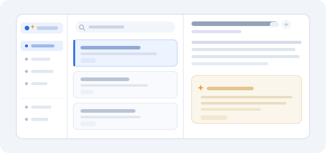

# RSS reader for DeepSeek Harness

[](https://github.com/qifenglun1/dsh-plugin-rss/actions/workflows/test.yml)

A Folo-inspired RSS and Atom information hub that runs natively inside DeepSeek Harness (DSH). It adds a full three-pane reading panel to the DSH Web GUI, stores everything locally, and uses the Harness model route for DeepSeek-powered summaries, translation, auto-classification, topic-based feed discovery, recommendations, and article Q&A.



## Features

- **RSS 2.0, Atom 1.0, RSS 1.0 (RDF), and JSON Feed** parsing, including `content:encoded`, XHTML content, enclosures, media thumbnails, and relative-link resolution.
- **Feed source management**: add a feed URL or a website URL (the page's advertised feed is discovered), edit titles, categories, and tags, pause/resume a feed, refresh one feed or all of them, and remove. A paused feed shows a marker in the rail and a resume banner in its view. A **Subscriptions** settings tab can restore the curated default feeds, recheck and delete invalid ones (3 failed refreshes in a row), or clear every subscription while keeping starred and read-later articles.
- **Topic-based feed discovery**: open **Discover feeds**, review topics inferred from your reading signals, saved articles, categories, and feed tags (or add your own), and let a curated directory plus DeepSeek suggest subscriptions. Every suggestion is fetched and parsed before it appears, already-subscribed sources are hidden, and you multi-select what to add with a category and tags.
- **Categories and tags** with unread counts, tag cloud filtering, and per-feed unread badges.
- **Three-pane reading experience** modeled on Folo: navigation rail, article list with unread dots and inline actions, and a focused reader. Narrow windows switch to a stacked list/reader flow with a back control, and the rail becomes a dismissible drawer.
- **Full-text reading**: a readability-style extractor that fetches the original page when a feed only ships a summary.
- **Content filters**: mute or highlight articles by title, body, author, or feed using substring or regular-expression rules.
- **Search** across title, tags, author, summary, and body with token scoring.
- **Favorites and read later**, plus mark-read / mark-unread / mark-all-read with a one-step undo for bulk marking.
- **DeepSeek AI**:
  - TL;DR plus key-point **summaries**, cached per article, with regenerate and copy actions.
  - Whole-article **translation** into your preferred language, also regenerable and copyable.
  - **Auto-classification** into categories and tags with a relevance score that stays visible in the AI card.
  - **Grounded Q&A** that answers only from the selected article and keeps a short conversation.
  - A **daily brief** across the most relevant unread articles.
  - **For you** ranking built from recency, reading history, starred/read-later signals, and feed/tag affinity, with an **AI rank** action that asks DeepSeek to re-rank the unread candidates and explain each pick.
- **OPML import and export**.
- **Update notices**: when the registry-installed package has a newer version, a notice banner appears at the top of the article list. **View update** opens this bundle's page in DSH's **Plugins** panel, where the built-in update flow checks compatibility, confirms the version, installs it, and restores the previous version when installation fails. Local link, path, Git and tarball installs are not updatable and show no notice.
- **Eight agent tools** so the model can manage subscriptions, discover feeds by topic, read/search articles, and run the same AI operations from chat.
- **Local-first storage** in one atomic JSON file, with corrupt-file recovery.

## Requirements

- DeepSeek Harness `0.2.x` with the Web GUI (Desktop or `dsh web`).
- A registered model route for AI features. The plugin inherits the Harness default model; no API key is stored by the plugin. AI features degrade gracefully when no model is configured.

## Install

See [INSTALL.md](INSTALL.md) for the full guide. In short, install it one of three ways:

- from npm: `plugin_manager action=install_bundle target=dsh-plugin-rss`
- from the GUI: **Plugins → Add plugin** and choose this directory
- from a session: `plugin_manager install_bundle` with the absolute path

When the page reloads, click the RSS icon in the sidebar panel rail.

## Use

1. Click the **RSS** icon in the sidebar panel list.
2. Click **+** to add a subscription. Paste a feed or site URL; optionally set a category and tags.
3. Choose **Discover feeds** in the sidebar footer. Topics inferred from your reading are shown with none selected; choose one or more (or type your own), then choose **Recommend feeds**. A radar indicator runs while curated and DeepSeek suggestions are matched and verified; the topic picker locks during the search, Cancel aborts the request and restores the previous suggestions, a truncated DeepSeek answer is retried with a larger output budget, and a failure still shows curated matches with a Retry action. Review the verified suggestions, select the ones you want, pick a category and tags, and add them in one batch. With no model route configured, the curated directory still provides suggestions.
4. Use the left rail for **All**, **Unread**, **For you**, **Starred**, **Read later**, categories, tags, and individual feeds. Hover or focus a feed to refresh or edit it.
5. Select a story to read it. The reader offers previous/next, mark-read, star, read later, full-text fetch, and open-original actions; in a narrow window a back control returns to the list. Mark all read shows an **Undo** action in the toast.
6. In the **AI assistant** card choose **Summary**, **Translate**, or **Ask**. Cached summaries and translations can be regenerated or copied. The sparkle action auto-classifies the article and keeps the categories and relevance visible; the double-sparkle action writes a daily brief. In **For you**, the list toolbar's double-sparkle action asks DeepSeek to re-rank the unread candidates and explain its picks.
7. **Settings** is a full-page view with seven tabs: **General** (refresh interval, page size), **AI** (route, languages, auto-classification), **Content filters**, **OPML** (file picker, paste area, import action fixed at the bottom, export), **Categories**, **Subscriptions** (restore defaults, delete invalid feeds after a preview and recheck, clear all), and **Keyboard shortcuts**.
8. **Content filters** now live in Settings, together with mute/highlight rule management. Articles hidden by a mute rule are reported in the list with a Show/Hide toggle.

## Keyboard shortcuts

Open **Settings → Keyboard shortcuts** in the RSS sidebar, or press `?`. Single-key shortcuts are ignored while you type in a field or while a dialog is open; `⌘/Ctrl+K` still focuses search.

| Key | Action |
|---|---|
| `j` / `↓` | Next article |
| `k` / `↑` | Previous article |
| `Enter` | Open the focused article card |
| `o` | Open original |
| `s` | Star / unstar |
| `b` | Read later / remove |
| `m` | Mark read / unread |
| `r` | Refresh all |
| `/` or `⌘/Ctrl+K` | Focus search |
| `?` | Show the shortcut help |
| `Esc` | Close the drawer or clear search; also closes the reader in a narrow window |

## Architecture

```
index.js                 Host plugin: config, store, API routes, tools, refresh loop
client.js                Browser bundle: main panel + sidebar entry (no build step)
src/config.js            Defaults and configuration normalization
src/util.js              Ids, dates, entities, URL helpers
src/xml.js               Tolerant XML/HTML tree parser
src/feed.js              RSS / Atom / RDF / JSON Feed normalization
src/html.js              Sanitizer, text conversion, readability extractor
src/http.js              Conditional HTTP with timeouts and byte caps
src/store.js             Durable JSON store, ingestion, views, filters, OPML state
src/rank.js              Filters, search scoring, recommendation score
src/discover.js          Topic inference, curated feed catalog, candidate merging
src/ai.js                DeepSeek prompts and one-shot model calls
src/engine.js            Refresh, subscription validation, full text, OPML import
src/api.js               Single operation layer shared by UI and tools
src/tools.js             Eight agent tools
test/                    126 unit, integration, and regression tests
```

### Host ↔ client

The Host registers three routes inside DSH's authenticated `/api` bridge:

- `POST /api/rss.rpc` — the `ctx.connection.rpc` envelope used by the panel.
- `GET /api/rss.state` — subscriptions, categories, counts, filters, settings, AI route.
- `POST /api/rss.call` — `{ method, params }` dispatched to the shared operation layer.

Feed discovery uses the same operation route (`discoverTopics`, `discoverFeeds`, `feedsAddBatch`); it adds no new transport route.

The browser bundle registers into three client slots:

- `main` (key `rss`) — the three-pane page.
- `sidebar.panellist` (id `rss`) — the RSS icon and label in the panel rail.
- Its own `rss` locale namespace with English and Simplified Chinese dictionaries.

Both the panel and the agent tools call the same `src/api.js` methods, so behavior and failures stay aligned.

### Data

State lives in `$DSH_HOME/rss/data.json` (for the desktop profile, `~/.dsh/rss/data.json`). Writes are debounced and atomic (temporary file + rename, mode `0600`). A corrupt file is moved aside to `data.json.corrupt-<timestamp>` and a fresh library is created.

Stored records include subscriptions, categories, articles with sanitized HTML, reading state, AI caches, filter rules, and interest weights. Articles above `maxArticles` are pruned oldest-first, except starred and read-later rows.

### Privacy

- Feeds and articles never leave the machine except as normal HTTP fetches of the URLs you subscribe to.
- AI actions send only the article text you act on (truncated to `aiMaxInputChars`) to the configured model route.
- Feed discovery sends the selected or inferred topics, existing subscription domains, and category names (never article bodies) to the configured model route. The curated catalog is matched locally.
- Article HTML is sanitized on ingest; scripts, styles, iframes, event handlers, and `javascript:` URLs are removed, and links open with `noopener noreferrer`.
- The plugin stores no credentials. It uses Harness's model configuration.

## Configuration

Configuration belongs to the bundle row in the profile's `cordis.patch.yml`. The defaults work without configuration.

```yaml
- insert:
    - id: rss
      name: 'dsh-plugin-rss'
      config:
        refreshMinutes: 30       # 0 disables the background refresh timer
        maxArticles: 3000
        pageSize: 40
        requestTimeoutMs: 25000
        maxFeedBytes: 8388608
        maxPageBytes: 6291456
        fullTextOnRefresh: false # fetch original pages for short entries
        allowPrivateHosts: false # allow loopback/LAN feeds (SSRF-sensitive)
        seedFeeds: true          # curated starter feeds on first run only; Restore default feeds is always available
        aiProvider: ''           # empty inherits the Harness default route
        aiModel: ''              # empty inherits the Harness default route
        aiMaxInputChars: 14000
        translateTo: ''          # empty picks English/Chinese from article language
        autoClassify: false
        refreshOnStart: true
```

`SEED_FEEDS` in `src/config.js` is the single source of truth for the default subscriptions: it seeds a fresh `data.json` and is exactly what **Restore default feeds** merges back (missing URLs only; existing rows keep their title, category, tags, and enabled state). The default set is 25 sources: AI (Google DeepMind, OpenAI News, Ahead of AI, Last Week in AI, Hugging Face Blog, Simon Willison’s Weblog, arXiv cs.AI, Google Research), Technology (Hacker News, The Verge, Ars Technica, The GitHub Blog, MacRumors, selfh.st, Hacker News Best, The Pragmatic Engineer, InfoQ, TechCrunch, MIT Technology Review), Science (Huberman Lab), and Recommended (Vox, Trump’s Truth, BBC 中文, NPR News, The Guardian World).

The Settings panel stores per-user overrides for the AI route, translation/answer language, refresh interval, page size, and auto-classification in the data file. A non-empty `aiProvider`/`aiModel` in the bundle configuration wins over the panel.

`refreshMinutes`, `pageSize`, `autoClassify`, and `translateTo` seed a **fresh** library. Once `data.json` exists, change them in the panel; editing the bundle configuration again does not override the stored values.

Requests to loopback, private, link-local, and cloud metadata hosts are rejected by default so a malicious OPML file or prompt-injected agent cannot make the plugin fetch internal services. Set `allowPrivateHosts: true` to subscribe to feeds on your own LAN.

## Agent tools

| Tool | Purpose |
|---|---|
| `rss_feeds` | List, add, update, or remove subscriptions; restore defaults, prune invalid feeds, or clear all (confirm required) |
| `rss_discover` | List inferred topics, recommend verified feeds for topics, or add explicitly selected URLs |
| `rss_articles` | List or search articles by view, feed, category, tag, or text |
| `rss_article` | Read one article, optionally fetch full text and mark read |
| `rss_refresh` | Refresh one feed or all enabled feeds |
| `rss_mark` | Change read/star/read-later state, or mark a view read |
| `rss_ai` | Summarize, translate, classify, ask, brief, recommend, or list models |
| `rss_filters` | List, add, or remove content filters |

A system-prompt section warns that feed content is untrusted data.

## Development

```sh
node --test test/*.test.js
```

Tests cover the XML parser, all four feed formats, sanitization and extraction, the store and persistence, ranking and filters, OPML, topic inference and the curated catalog, AI prompt parsing with a fake model, the shared operation layer with a mocked network, host route/tool wiring, bulk-mark undo, and client render/locale checks.

There is no build step: `client.js` is a plain `window.__ModuleLoader__` bundle and the Host is ESM JavaScript.

## Limitations

- Single-user, local-only; there is no sync service.
- Background refresh runs only while DSH is running.
- Full-text extraction is heuristic and cannot read paywalled or JavaScript-rendered pages.
- One translation is cached per article per language; changing language regenerates it.
- AI features require a working model route and consume tokens on that route.
- Feed discovery only shows URLs that fetch and parse successfully; sources behind logins, JavaScript-only pages, or temporary outages are skipped. The curated catalog is finite, so uncommon topics rely on the model route.
- Remote images in articles are loaded directly from their publishers.
- The plugin does not scrape content behind authentication.
- Article URLs and feed links are accepted only when they use `http:` or `https:`.
- User filter regular expressions are restricted to a backtracking-safe subset (no quantified groups, lookarounds, or backreferences); matching examines the first 2,000 characters of a field.
- Update notices only appear for a package installed from a registry through DSH's plugin manager; a development `link:` install reports `not-updatable` and shows nothing. The notice is panel-scoped: it appears at the top of the article list when the RSS panel loads, so it is not visible from other DSH panels. A panel load rechecks at most every 10 minutes, and **View update** asks again when the panel returns, so an installed update clears the notice.
